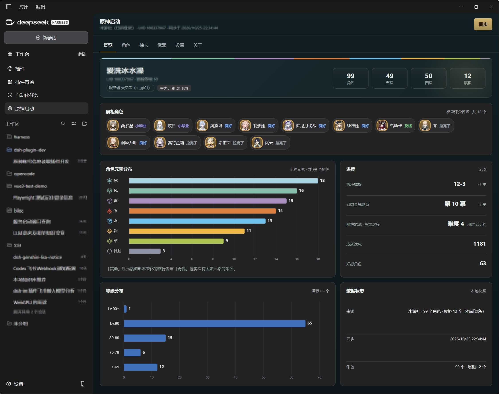
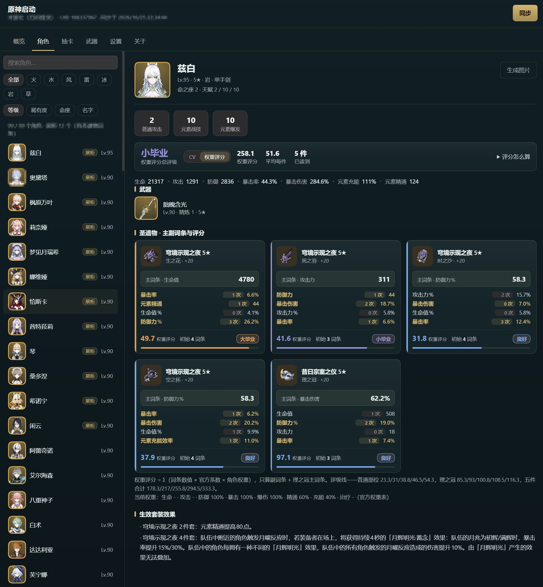
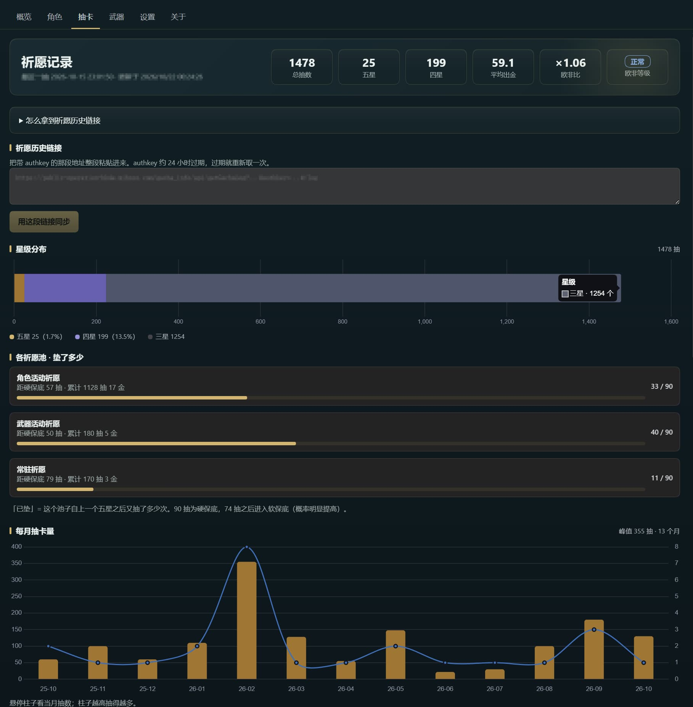
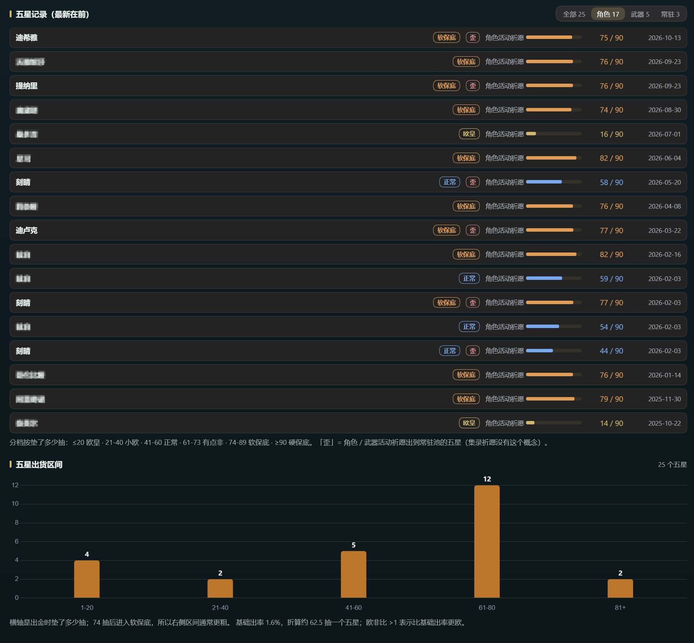

# dsh-genshin-account

DeepSeek Harness 插件：把**你的原神账号**读成一份快照，然后在两处用起来 —— 对话里问（agent 工具），界面上看（侧边栏「**原神启动**」）。

A DeepSeek Harness plugin that reads your Genshin Impact account into one snapshot and exposes it as **agent tools** plus a **GUI panel**.

---

## 截图

概览：账号主卡、展柜角色评分一览、元素分布与进度。



角色页：完整练度、五件圣遗物与逐条副词条评分。



抽卡页：星级分布、各池保底进度、每月抽卡量（柱 + 折线）。



五星记录与出货区间：欧非分档、「歪」标记、区间分布。



---

## 能做什么

侧边栏「原神启动」六个页签：

| 页签 | 内容 |
| --- | --- |
| **概览** | 账号主卡（昵称 / UID / 冒险等级 / 区服 / 主元素）、角色·五星·四星·展柜数字块、展柜角色评分一览、元素分布、等级分布、进度与数据状态 |
| **角色** | 左侧列表（官方头像 + 元素描边，可搜索、按元素筛选、按等级/稀有度/命座/名字排序），右侧完整练度：命座、三段天赋、面板、武器、五件圣遗物与评分、生效套装效果；右上角可导出长图 |
| **抽卡** | 总抽数 / 五星 / 四星 / 平均出金 / 欧非比、各池抽数与保底进度、星级分布、每月抽卡量、五星出货区间、五星记录（带欧非分档与「歪」标记） |
| **武器** | 卡片网格（官方图标 + 稀有度描边），按类型 / 星级筛选 |
| **设置** | UID、扫码登录、安全验证、展柜重新同步 |
| **关于** | 版本、仓库、博客、功能说明 |

明暗主题自适应；所有游戏图标来自官方 CDN，元素图标内联在包里，离线可用。

---

## 安装

```sh
dsh plugin --profile web add github:EagleClark/dsh-genshin-account
```

本地开发可以装成 link（改完即时生效）：

```sh
dsh plugin --profile web add <仓库绝对路径>
```

装完**重启 DSH**，刷新页面即可看到「原神启动」。

---

## 配置（都在页面里，不用改文件）

第一次打开会落在**设置**页，三步：

1. **填国服 UID** —— 服务器按 UID 自动判断（1/2 → 天空岛 `cn_gf01`，5 → 世界树 `cn_qd01`）
2. **扫码登录** —— 点「生成二维码」，用手机米游社 App 扫码确认；会话由插件自己从 `Set-Cookie` 取，不需要你复制 Cookie
3. **安全验证** —— 拖一次 geetest 滑块，通过后插件自动换取 `x-rpc-challenge` 并立刻读取账号

验证是**按接口**发放的（`/index` 与 `/character/list` 各一次），所以可能连续弹两次滑块；通过后自动完成，不需要重新配置。

页面里还有**接口诊断**：用当前会话依次请求三个接口并逐个报告返回码，排查时比猜有用。

Cookie 只存在本机，`/state` 从不回显（只回 `hasCookie: true/false`）。

---

## 数据来源

| 数据 | 来源 | 需要登录 |
| --- | --- | --- |
| 全部角色、等级、命座、三段天赋、武器名与等级、圣遗物部位与等级 | 养成计算器 `api-takumi.mihoyo.com/.../sync/avatar/detail` | 是 |
| 圣遗物**主副词条**、角色面板、武器精炼 | 游戏内「角色展柜」→ `profile.microgg.cn/api/uid/<uid>`（国际服回落 `enka.network`） | 否，按 UID 公开 |
| 深境螺旋 / 幻想真境剧诗 / 幽境危战 / 成就 / 好感 | 展柜 payload 的 `playerInfo` 与 `role_combat` / `hard_challenge` | 否 |
| 祈愿记录 | `getGachaLog`（需手动粘贴一次链接） | 否，但 authkey 约 24 小时过期 |

**展柜是圣遗物副词条唯一的通路**：把角色放进游戏内「角色展柜」并开启「显示详情」，等 5 分钟，再同步。上限 8 个角色，其余角色只有部位、散件名和等级。

祈愿链接这样拿：游戏内打开一次祈愿历史，然后运行

```powershell
iex(irm 'https://www.lelaer.com/cn.ps1')
```

把复制到的整段链接粘进抽卡页即可。

---

## 评分怎么算

插件给每件圣遗物两个**可解释**的数，都不假装是伤害计算。

### CV（暴击值）

`CV = 暴击率 × 2 + 暴击伤害`，只算副词条；理之冠主词条是双暴时也计入（暴击率 31.1% 记 62.2）。

| 部位 | 拉完了 | 及格 | 良好 | 小毕业 | 大毕业 | 传家宝 |
| --- | --- | --- | --- | --- | --- | --- |
| 生之花 / 死之羽 | <30 | 30–34 | 35–39 | 40–44 | 45–49 | ≥50 |
| 时之沙 / 空之杯 | <25 | 25–29 | 30–34 | 35–39 | 40–44 | ≥45 |
| 理之冠 | <50 | 50–59 | 60–69 | 70–79 | 80–94 | ≥95 |

五件合计按「各档下限之和」：及格 160 / 良好 190 / 小毕业 220 / 大毕业 250 / 传家宝 285。

### 权重评分（角色页默认）

`评分 = Σ（词条数值 × 官方系数 × 该角色权重）`，只算副词条 + 理之冠主词条。

| 词条 | 系数 | 词条 | 系数 |
| --- | --- | --- | --- |
| 暴击率 | ×2 | 大攻击 / 大生命 | ×1.33 |
| 暴击伤害 | ×1 | 大防御 | ×1.06 |
| 元素精通 | ×0.33 | 小攻击 | ×0.199 |
| 元素充能 | ×1.1979 | 小生命 / 小防御 | ×0.0172 / ×0.221 |

角色权重在 `data/character-weights.json`（120 个角色 × 8 项，按百分比存），未收录的回落「通用」模板。
一次满档强化约 7.75 分；六档门槛：普通部位 23.3 / 31 / 38.8 / 46.5 / 54.3，理之冠 85.3 / 93 / 100.8 / 108.5 / 116.3，五件合计 178.3 / 217 / 255.8 / 294.5 / 333.3。

角色页可在 **CV / 权重评分** 之间切换，卡片与总分一起变。

### 强化次数与初始词条

接口只给最终数值，但每次强化只能取官方四档，所以数值可以**唯一分解**成强化次数：卡片上 `3 次` 是精确次数，`≈4` 表示需要靠整件总次数约束求解。总次数减升级次数就是初始词条数（5★ +20 共 5 次）。

---

## 抽卡

- 池子：新手 / 常驻 / 角色活动（301 与 400 共享保底）/ 武器活动 / 集录
- 平均出金、欧非比（相对 1.6% 基础出率的倍率）
- 五星记录带**六级欧非分档**与「歪」标记（常驻五星判定）
- 图表：星级分布（横向堆叠柱）、每月抽卡量（柱 + 折线双轴）、五星出货区间（柱 + 数值标签）

图表用 **Chart.js 4**（MIT）。库已内联进客户端包，不新增任何路由，也不显示第三方标识。

---

## Agent 工具

装好后自动获得 6 个工具：

| 工具 | 作用 |
| --- | --- |
| `genshin_account_overview` | 账号总览：数量、元素分布、进度、最佳圣遗物 |
| `genshin_characters` | 角色列表，按元素 / 武器类型 / 最低等级过滤与排序 |
| `genshin_character` | 单个角色完整练度（支持中文名 / 英文名 / 别名 / id） |
| `genshin_artifacts` | 圣遗物筛选与排序（套装、部位、角色、最低 CV） |
| `genshin_weapons` | 武器筛选（类型、最低稀有度、是否已装备） |
| `genshin_gacha` | 祈愿分析：抽数、平均出金、欧非比、各池保底、五星记录 |

返回结构化 JSON 同时附一份给人看的文本；数据不可用时给可读的错误，不抛异常。

---

## 数据文件

`data/` 是精简过的中文字典，运行时不需要网络：

| 文件 | 内容 |
| --- | --- |
| `characters.json` | 124 个角色：中文名 / 英文名 / 元素 / 武器类型 / 稀有度 / 别名 |
| `weapons.json` | 255 把武器：中文名 / 类型 / 稀有度 |
| `artifact-sets.json` | 63 套圣遗物：中文名 + 2 / 4 件套效果原文 |
| `character-weights.json` | 120 个角色的权重评分系数 |
| `weapon-details.json` | 90 级基础攻击、副属性、精炼 1–5 被动原文 |
| `aliases.json` / `names-zh.json` | 别名与 hash 索引 |
| `skill-orders.json` | 每角色的「普攻 / 战技 / 爆发」顺序（技能 id 不按此递增，按 id 排序会张冠李戴） |
| `element-icons/*.webp` | 官方七元素图标母图；`scripts/build-element-icons.mjs` 转成 96px PNG 内联进包 |

---

## 已知限制

- **角色与武器需要登录态**；展柜按 UID 公开可读，是唯一例外
- **圣遗物只覆盖展柜角色**（最多 8 个），其余角色只有部位、散件名与等级
- **展柜有 5 分钟延迟**
- **逆向接口**：签名盐与 `app_version` 会随官方改版失效（`-10001`），届时在高级设置里更新；频繁请求会被限流
- CV 与权重评分是**通用质量指标**，不等于角色收益，更不是伤害计算
- 4★ 圣遗物的强化位数按 7 位估算，可能与游戏内差一位

---

## 开发

```sh
npm test                                   # 13 个测试文件
node scripts/ui-preview.mjs                # 渲染各页签截图到临时目录
PREVIEW_LOCAL=1 node scripts/ui-preview.mjs  # 用仓库代码现算快照
```

预览需要 `react` / `react-dom`（放 `REACT_DIR`）与 Edge。面板要等 effect 填数据才有内容，静态渲染看不出真实排版。

重新生成数据（需要网络，仅开发时）：

```sh
node scripts/build-dict.mjs <genshin-db 路径>
node scripts/build-names.mjs
node scripts/build-skill-orders.mjs
node scripts/build-weapon-details.mjs
node scripts/build-character-weights.mjs
node scripts/build-element-icons.mjs   # 改了元素母图后重跑
node scripts/inline-chart.mjs          # 升级 chart.js 后重跑
```

游戏更新后名字缺失，重跑前四条即可，插件本身不用改。

路由（15 条，全部同源）：`/state` `/summary` `/character` `/artifacts` `/weapons` `/sync` `/gacha` `/gacha/sync` `/login/qr` `/login/poll` `/verify/widget` `/verify/start` `/verify/finish` `/probe-miyoushe` `/diag`。

---

## 许可

MIT。随包游戏数据由 [genshin-db](https://github.com/theBowja/genshin-db)（MIT）与 [EnkaNetwork/API-docs](https://github.com/EnkaNetwork/API-docs) 生成，游戏名称与内容版权归米哈游所有。
